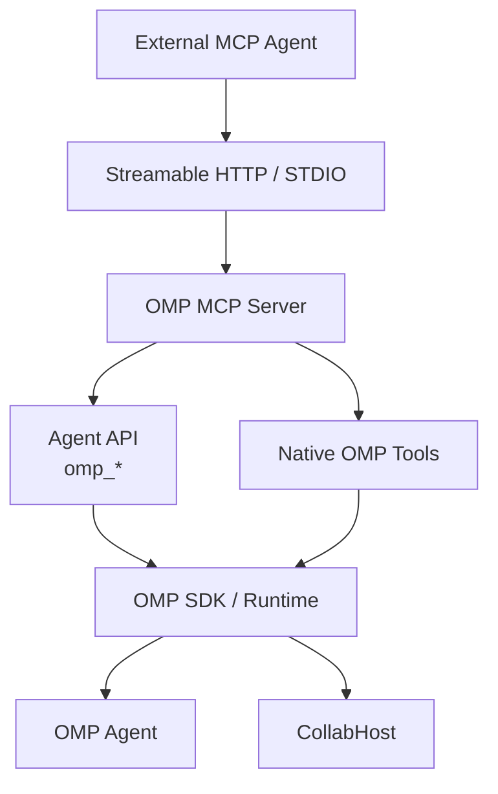

# 🧩 OMP MCP Server

   

> 🔌 Expose the native [Oh My Pi (OMP)](https://github.com/oh-my-pi/oh-my-pi) agent runtime and tools to MCP-compatible clients.


It provides two capabilities:

- an `omp_*` agent/session API for running and controlling OMP sessions;
- OMP's native tools directly through the MCP server.

The server supports both **Streamable HTTP** and **STDIO** transports. The default configuration is Streamable HTTP, which is suitable for running the server as a long-lived systemd service. For browser automation through OMP's Browser Relay, the deployment can also run the Relay as a separate systemd service.

## 🧭 Status

The dashboard frontend is maintained separately in the standalone omp-control project. This repository retains the /api/* runtime endpoints consumed by that UI and no longer builds or serves the bundled frontend.

The server uses OMP's native SDK/runtime for agent sessions and native tools, with optional Collab integration for session collaboration links. Session metadata is persisted in the local SQLite control database; SDK transcript files are used to rehydrate sessions after restart when available.

The `sudo_exec` tool is an opt-in, high-risk tool. OMP Control exposes per-instance **Root command rules** under Tool permissions. Rules are persisted as JSON in the `workspace_prefs` table of the instance's SQLite control database. On first access, OMP-MCP seeds `shutdown now` and `reboot now` examples; both are **disabled by default**.

The UI accepts a command name such as `systemctl`, while the backend resolves it only from trusted system directories. An exact command-and-argument match in an enabled rule bypasses approval. Other commands follow the normal OMP-MCP permission policy and may run after approval. Commands are executed directly without shell parsing; shell/interpreter executables, wildcard matching, and shell chaining are not supported. Approval does not make a command harmless, so keep permissions and arguments narrow.

Set `OMP_SUDO_ENCRYPTION_KEY` to a private, stable value of at least 32 characters on each OMP-MCP instance before saving a sudo password. The password is stored encrypted in that instance's SQLite control database and is never returned by the configuration API. Do not reuse this key across unrelated hosts. The runtime needs `sudo` installed and the service account must be authorized to use it. Keep rules narrow: an explicitly allowed executable/argument pair can still perform powerful system changes.

## 📋 Requirements

- Bun 1.4+
- OMP 18.4.10+ (or a compatible version exposing the required SDK/runtime APIs)
- An OMP-authenticated model environment
- Linux for the recommended systemd deployment

## 🚀 Installation

### 🧪 Development

```bash
bun install
```

Run locally:

```bash
bun run start
```

For development with file watching:

```bash
bun run dev
```

### Production with systemd

The repository includes a Makefile-based deployment for Linux:

```bash
sudo make setup
sudo make start
sudo make status
```

`make setup` installs the application to `/opt/omp-mcp`, creates the persistent data directory at `/var/lib/omp-mcp`, installs the OMP MCP and optional integration systemd units, and enables **only `omp-mcp.service`** at boot. During setup, it generates `OMP_API_TOKEN` and `OMP_SUDO_ENCRYPTION_KEY` using random 256-bit values when they are not already configured, and prompts for the OAuth public HTTPS origin, username, and hidden password. Leave the public URL blank to keep OAuth disabled. Existing tokens and encryption keys are preserved when setup is rerun. The MCP server does not depend on the optional services and can run if either is missing or fails. The services run as the existing `pstar7` user; OMP MCP uses the Bun binary installed under `/opt/omp-mcp/bin`.

The command sudo make update updates application source and production dependencies in /opt/omp-mcp, then restarts omp-mcp.service. It does not run the installer, rewrite .env, or change systemd unit configuration. To update from a published Git tag instead of the current checkout, use sudo make update VERSION=x.y.z. Use make install only when you intentionally need to install or reconfigure the service.

The deployment includes the following services:

- `omp-mcp.service` — the MCP server, listening on the configured Streamable HTTP endpoint.
- `omp-mcp-browser-relay.service` — optional Browser Relay on `127.0.0.1:9224`, allowing OMP's browser tools to drive connected Chrome/Brave tabs through the Browser Relay extension.
- `ydotoold.service` — optional daemon for desktop input automation; only needed for tools that use `ydotool`.

Optional units are installed but **not enabled or started by default**. If upgrading an installation that previously enabled them, disable unused units once with: sudo systemctl disable --now omp-mcp-browser-relay.service ydotoold.service. Enable an optional unit only on a machine where you use that integration:

```bash
sudo systemctl enable --now omp-mcp-browser-relay.service
sudo systemctl enable --now ydotoold.service
```

Or manage them through Make targets such as `sudo make start relay`, `sudo make status ydotoold`, and `sudo make logs relay`. Optional service failures will not prevent the MCP server from starting.

Check the main service with:

```bash
sudo make status
```

Follow the main service's logs with:

```bash
sudo make logs
```

To retrieve the configured credentials from the protected `/opt/omp-mcp/.env` file, use:

```bash
sudo make token
sudo make oauth
```

`make token` prints `OMP_API_TOKEN`; `make oauth` prints the OAuth public URL, username, and password plus whether OAuth is configured. These commands reveal secrets in the terminal, so use them only in a trusted session. They display existing values and do not generate or rotate credentials.

The default deployment configuration uses Streamable HTTP:

```text
http://127.0.0.1:48765/mcp
```

To inspect logs:

```bash
make logs
```

To update an existing installation from the current checkout:

```bash
sudo make update
```

To deploy an exact released version, use its Git tag:

```bash
sudo make update VERSION=v0.1.0
```

When `VERSION` is provided, the update fetches the tag from the repository and installs exactly that release. Without `VERSION`, it installs the current working tree.

To remove the application while preserving service data/workspaces:

```bash
sudo make uninstall
```

To remove the application, service data/workspaces, service user, and service group:

```bash
sudo make purge
```

Both removal commands are idempotent and verify that their managed resources were removed.

## ⚙️ Configuration

Configuration is loaded from environment variables. Bun automatically loads `.env` files.

Example:

```env
# Runtime
NODE_ENV=production
LOG_LEVEL=info

# MCP transport
# stdio | http | both
MCP_TRANSPORT=http
MCP_HTTP_HOST=127.0.0.1
MCP_HTTP_PORT=48765
MCP_HTTP_PATH=/mcp

# Required for OMP Control and internal HTTP endpoints. The MCP endpoint also accepts OAuth access tokens when OAuth is configured.
# Generate a strong secret with `openssl rand -hex 32` and set the same value as the OMP Control instance credential.
OMP_API_TOKEN=

# Optional OAuth 2.0 for remote MCP clients (requires a public HTTPS URL)
# Use the public origin of this MCP server, without /mcp or another path.
MCP_PUBLIC_URL=https://mcp.example.com
OMP_OAUTH_USERNAME=
OMP_OAUTH_PASSWORD=

# OMP
OMP_DEFAULT_CWD=/var/lib/omp-mcp/workspace
```

### Transport modes

- `http` — Streamable HTTP only; recommended for systemd/server deployments.
- `stdio` — MCP over stdin/stdout; useful when another process launches `omp-mcp` directly.
- `both` — runs both transports in the same process.

`OMP_DEFAULT_CWD` is the default working directory used when an `omp_*` tool does not receive an explicit `cwd`. It is a convenience default, not a filesystem sandbox; callers can provide another working directory when needed.

### OAuth 2.0 for remote MCP clients

Set `MCP_PUBLIC_URL` to the public HTTPS origin that serves OMP-MCP, plus `OMP_OAUTH_USERNAME` and `OMP_OAUTH_PASSWORD` to enable OAuth authorization-code flow with PKCE (S256). Configure these secrets in the service environment; do not commit them. OAuth access tokens are stored as SHA-256 hashes in the control-plane SQLite database, expire after one hour, and use rotating refresh tokens. Dynamic client registration is enabled for public clients.

For systemd installations, `make setup` prompts for the public HTTPS origin, username, and password. Leave the public URL blank to keep OAuth disabled. To change these values later, edit `/opt/omp-mcp/.env` and restart OMP-MCP. `make install` / `make update` append missing OAuth variable names without overwriting current settings.

The OAuth authorization server exposes `/.well-known/oauth-authorization-server`, `/.well-known/oauth-protected-resource`, `/oauth/register`, `/oauth/authorize`, `/oauth/token`, and `/oauth/revoke`. Remote clients should use the discovery metadata rather than hard-coding endpoint details.

The hosted login page follows the OMP Control visual style and provides a dark/light theme toggle. It follows the operating-system theme by default and remembers a manual selection in the browser.

The OAuth login uses the dedicated OMP OAuth username/password configured above; it is not automatically linked to an OMP Control browser session. Keep `OMP_API_TOKEN` configured for the OMP Control API and internal clients. OAuth credentials authorize MCP tool access only; other HTTP control-plane endpoints continue to require the internal Bearer token. Use HTTPS end-to-end and back up the control-plane database.

### Cloudflare Tunnel management

OMP-MCP manages Cloudflare Quick Tunnel processes on the OMP-MCP host. Install `cloudflared` on that host. Tunnel endpoints use the same global `OMP_API_TOKEN` Bearer authentication as the rest of the HTTP API; there is no separate tunnel token. Tunnel targets are restricted to loopback HTTP(S) URLs.

The MCP tools `tunnel_list`, `tunnel_status`, `tunnel_start`, and `tunnel_stop` are also exposed through OMP-MCP's tool permission system.

## 🛠️ Tools

The server exposes two layers.

### Tool catalog and permission rules

OMP-MCP's `GET /api/tools` endpoint is the source of truth consumed by OMP-Control. The catalog combines OMP-MCP's registered built-in tools with the currently enabled native OMP tools; the native set is discovered at runtime. Tool exposure and execution permissions are enforced by OMP-MCP, not by the dashboard UI.

The `custom` permission mode supports a saved rule with multiple conditions. Conditions can match **all (AND)** or **any (OR)** and apply one action when matched plus a fallback action otherwise. Supported fields are `tool.name`, `tool.risk`, and nested input arguments such as `args.path` or `args.command`. Operators: `equals`, `not_equals`, `contains`, `not_contains`, `starts_with`, `ends_with`, `greater_than`, `less_than`, `exists`, `not_exists`, `in`, and `not_in`. Actions are `allow`, `require_approval`, and `block`. For `in`/`not_in`, provide a comma-separated list. Existing named rules are normalized for compatibility with saved settings.

### Browser automation

OMP's `eval` tool can use the global `browser` API. Browser Relay can adopt and control an existing Chrome/Brave tab when the OMP Browser Relay extension is connected.

For a connected existing browser tab, use:

```js
const tab = await browser.open({
  name: "current",
  app: { relay: true },
});

return {
  url: await tab.url(),
  title: await tab.title(),
};
```

`browser.tabs()` lists OMP-managed browser handles, not necessarily every physical tab currently open in Chrome/Brave. Relay is local and uses the user's real browser session, including its logged-in state.

### Agent API (`omp_*`)

- `omp_run`: starts an OMP agent session using the native OMP SDK/runtime.
- `omp_status`: returns session status and Collab metadata.
- `omp_result`: returns the latest assistant result tracked by the MCP session manager.
- `omp_resume`: sends another instruction to a running OMP session.
- `omp_interrupt`: interrupts a running OMP agent session.
- `omp_list`: lists all sessions known to this MCP server, including completed sessions.
- `omp_collab`: retrieves a session's Collab URL or lists currently active Collab hosts.

Future agent-protocol operations such as prompt/steer/follow-up can use the same `omp_*` namespace.

### Native OMP tools

The MCP server also exposes OMP's built-in tools under their original names, without an `omp_` prefix. They execute directly through OMP's native SDK/tool registry and do not require an OMP agent session.

Typical tools include:

- `read`
- `write`
- `edit`
- `bash`
- `grep`
- `glob`
- `lsp`
- `ast_edit`
- `debug`
- `eval`
- `task`
- `wait`
- `todo`
- `web_search`

The exact native set follows the installed OMP version and its effective settings. Disabled OMP tools are not registered by the MCP server.

### Example `omp_run`

```json
{
  "task": "Fix the authentication bug",
  "cwd": "/home/user/project"
}
```

The response contains the managed session metadata and status.

## 🌐 Streamable HTTP

The recommended server deployment uses MCP Streamable HTTP:

```text
http://127.0.0.1:48765/mcp
```

The endpoint is configured with `MCP_HTTP_HOST`, `MCP_HTTP_PORT`, and `MCP_HTTP_PATH`.

Every HTTP request must include `Authorization: Bearer <OMP_API_TOKEN>`. This applies to MCP initialization and subsequent session requests, all `/api/*` endpoints, and terminal WebSocket upgrades. OMP Control forwards the selected instance credential as the Bearer token.

The server manages MCP HTTP sessions independently while sharing the underlying OMP runtime in the process.

## 🤝 Collaboration (Collab)

OMP sessions can optionally start a native `CollabHost` and expose browser collaboration links through `omp_collab`.

The `omp_collab` tool returns the active browser collaboration links for a session.

Collab availability depends on the OMP installation being authenticated and able to reach its configured relay.

Collab URLs should be treated as sensitive access links and should not be written to logs.

## 🧪 Development

```bash
bun run typecheck
bun test
```

### 📦 Releases

Releases use Semantic Versioning and Git tags. The `release` target validates the source, updates `package.json`, creates an annotated `vX.Y.Z` tag, and pushes the commit and tag to the remote.

```bash
make release VERSION=0.2.0
```

Use PATCH for backward-compatible fixes, MINOR for backward-compatible features, and MAJOR for breaking changes. Release from a clean `main` branch.

## 🏗️ Architecture



## ⚠️ Current limitations

- Session recovery depends on the persisted SDK transcript still being available and compatible with the installed OMP version.
- The recommended HTTP deployment currently binds to `127.0.0.1`; expose it through a reverse proxy or other network boundary if remote clients are required.
- HTTP mode requires `OMP_API_TOKEN`; all HTTP endpoints, including Streamable HTTP MCP, REST APIs, and terminal WebSocket upgrades, reject missing or invalid Bearer credentials. STDIO transport does not use HTTP authentication.
- Collab availability depends on the OMP installation being authenticated and able to reach its configured relay.

## Documentation

- `ARCHITECTURE.md` — runtime modules, MCP transports, persistence, API boundaries, and security model.
- `DESIGN.md` — hosted OAuth interface, API consistency, and permission/safety UX conventions.
- `CONTRIBUTING.md` — development workflow, validation, migrations, and contribution checklist.
- `deploy/README.md` — deployment-specific notes and operational instructions.
